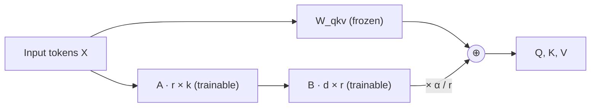

# TabPFN-LoRA

**Parameter-efficient fine-tuning for the TabPFN tabular foundation model.**
Low-rank adapters (LoRA) are injected into the query/key/value projection of every attention layer, while all pretrained weights stay frozen. You adapt a foundation model to a new tabular dataset by training a few thousand parameters instead of the whole network.

---

## Why

TabPFN is a transformer pretrained to solve tabular prediction tasks in-context. Fine-tuning it end to end on a large, domain-specific dataset is expensive and can erase what pretraining taught it. LoRA keeps the backbone intact and learns only a small low-rank update on top of it:

$$
W'_{qkv} \;=\; W_{qkv} \;+\; \frac{\alpha}{r}\, B A,
\qquad B \in \mathbb{R}^{d \times r},\;\; A \in \mathbb{R}^{r \times k},\;\; r \ll d
$$

- `A` is initialised Kaiming-uniform and `B` with zeros, so at step 0 the adapter is a no-op and the model behaves exactly like pretrained TabPFN.
- Only `A` and `B` receive gradients; every other parameter is frozen.
- The update is scaled by `alpha / r`, so the rank can change without retuning the learning rate.

This was built to adapt TabPFN to a large proprietary tabular dataset (30M+ rows) without expensive end-to-end retraining. That dataset is not part of this repository; the bundled Titanic split is a runnable demo.

## How it works



| Piece | Where |
|---|---|
| LoRA parameters on the fused QKV weight, `enable_lora(r, alpha)` | `tabpfn/architectures/base/attention/full_attention.py` |
| `lora_r`, `lora_alpha` in the model config | `tabpfn/architectures/base/config.py` |
| Enable adapters on every attention module, freeze everything except `lora_A` / `lora_B` | `tabpfn/finetuning/finetuned_base.py` |
| `lora_r` / `lora_alpha` exposed on the estimators | `tabpfn/finetuning/finetuned_classifier.py`, `finetuned_regressor.py` |

Everything else is upstream [TabPFN](https://github.com/PriorLabs/TabPFN) code (see [NOTICE](NOTICE)).

## Setup

Requires Python 3.9+. A CUDA GPU is recommended; CPU works for small datasets.

```bash
git clone https://github.com/stevesojan/tabpfn-lora.git
cd tabpfn-lora
python -m venv .venv
source .venv/bin/activate          # Windows: .venv\Scripts\activate
pip install -e ".[notebook]"
```

TabPFN downloads its pretrained checkpoint from Hugging Face. The checkpoint repository is gated: accept its terms on the model page while signed in, create an access token at <https://huggingface.co/settings/tokens>, and provide it through the environment:

```bash
cp .env.example .env               # then set HF_TOKEN=... in .env
# or: export HF_TOKEN=...
```

Never commit the token; `.env` is git-ignored.

## Quick start

```python
from pathlib import Path
from tabpfn.finetuning import FinetunedTabPFNClassifier

clf = FinetunedTabPFNClassifier(
    device="cuda",          # or "cpu"
    epochs=30,
    learning_rate=1e-4,
    lora_r=8,               # adapter rank
    lora_alpha=16.0,        # adapter scale: delta = (alpha / r) * B @ A
)
clf.fit(X_train, y_train, output_dir=Path("tabpfn_checkpoints/run01"))

proba = clf.predict_proba(X_test)
labels = clf.predict(X_test)
```

Regression works the same way with `FinetunedTabPFNRegressor`.

Check that only the adapters are trainable:

```python
model = clf.finetuned_inference_classifier_.model_
trainable = [n for n, p in model.named_parameters() if p.requires_grad]
print(len(trainable), "trainable tensors, e.g.", trainable[:2])   # only *_lora_A / *_lora_B
print(sum(p.numel() for p in model.parameters() if p.requires_grad), "trainable parameters")
```

## Demo notebook

`tabpfn/tabpfn_lora_finetune.ipynb` runs the full loop on the Titanic dataset: it builds a train / held-out split, fine-tunes with LoRA (r = 8, α = 16), and lists the trainable parameters. Run it from the `tabpfn/` directory so its relative paths resolve:

```bash
cd tabpfn
jupyter notebook tabpfn_lora_finetune.ipynb
```

## Key parameters

| Parameter | Default | Meaning |
|---|---|---|
| `lora_r` | `8` | Rank of the adapter matrices. Higher means more capacity and more trainable parameters. |
| `lora_alpha` | `8.0` | Scale of the update; the effective multiplier is `lora_alpha / lora_r`. |
| `epochs` | `30` | Maximum fine-tuning epochs (early stopping is on by default). |
| `learning_rate` | `1e-5` | Optimiser learning rate for the adapter parameters. |
| `device` | `"cuda"` | Training device. |
| `n_estimators_finetune` / `_validation` / `_final_inference` | `2` / `2` / `8` | Ensemble sizes used while training, validating and predicting. |
| `early_stopping`, `early_stopping_patience` | `True`, `8` | Stop when validation stops improving. |
| `save_checkpoint_interval` | `10` | Epochs between checkpoints written to `output_dir`. |

## Project layout

```
tabpfn/
  architectures/base/attention/full_attention.py   # LoRA on the QKV projection
  architectures/base/config.py                      # lora_r / lora_alpha config
  finetuning/                                       # fine-tuning loop, LoRA enable + freeze
  tabpfn_lora_finetune.ipynb                        # end-to-end demo
  titanic_dataset/                                  # demo data
.env.example                                        # HF_TOKEN placeholder
NOTICE                                              # upstream attribution + modified files
```

## License

Apache License 2.0; see [LICENSE](LICENSE). This project includes and modifies source code from [TabPFN](https://github.com/PriorLabs/TabPFN) by Prior Labs, also Apache-2.0, as described in [NOTICE](NOTICE). Pretrained TabPFN model weights are downloaded from Hugging Face and are governed by their own license.
